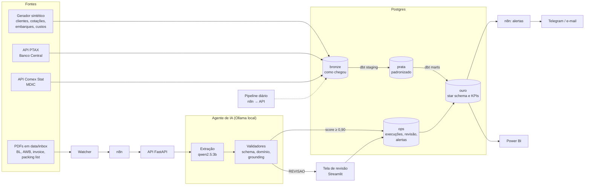

# Arquitetura

O FlowStream-Comex simula a plataforma de dados de um agente de cargas internacional de
Itajaí (SC): recebe dados operacionais, comerciais, financeiros e documentos de embarque,
organiza tudo em PostgreSQL e entrega indicadores e alertas. Tudo roda localmente, com
software gratuito, em uma máquina de 8 GB de RAM.

## Fluxo completo

## Camadas do banco

| Schema | Papel | Quem escreve |
| --- | --- | --- |
| `bronze` | Dados exatamente como chegaram, com `loaded_at` | Ingestão (Python) |
| `prata` | Dados tipados, padronizados (UN/LOCODE, ISO 4217) e deduplicados | dbt (staging, intermediate) |
| `ouro` | Dimensões, fatos e KPIs consumidos pelo Power BI e pelos alertas | dbt (marts) |
| `ops` | Log de execuções, documentos, extrações, revisões, alertas enviados | Aplicação |

## Organização do código

Cada módulo de negócio em `src/flowstream/<módulo>/` separa responsabilidades:

- `domain.py` — modelos e regras puras, sem I/O; é o que tem maior cobertura de testes.
- `service.py` — orquestra o caso de uso.
- `adapters.py` — HTTP, banco e arquivos.

A configuração vem só de variáveis de ambiente (`flowstream.config.Settings`), e todo log
passa por `flowstream.logging`, que mascara CNPJ, CPF e e-mail.

## Restrições de memória

| Componente | Limite | Observação |
| --- | --- | --- |
| PostgreSQL | 512 MB | `shared_buffers=128MB` |
| n8n | 512 MB | Usa o mesmo Postgres |
| Ollama + qwen2.5:3b | ~2,5 GB | Fora do Docker; uma chamada por vez |
| Power BI Desktop | ~1,5 GB | Aberto só com o Ollama parado |

Decisões de arquitetura estão registradas em [adr/](adr/README.md).
