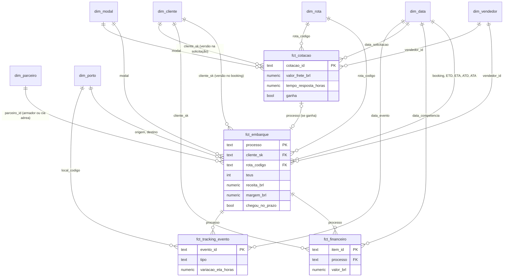

# Modelo de dados

Três camadas no PostgreSQL, construídas pelo dbt (`make dbt`): **bronze** (como chegou, escrito
pela aplicação Python), **prata** (padronizada, P05) e **ouro** (star schema e KPIs, P06).
Catálogo navegável: `make dbt-docs` e abrir `dbt/target/index.html`.

## Star schema (ouro)

## Fatos

| Fato | Grão | Chave | Medidas |
| --- | --- | --- | --- |
| `fct_embarque` | processo | `processo` | TEUs, equipamentos, peso, volume, transit previsto e real, atrasos, `chegou_no_prazo`, receita/custo/margem em BRL |
| `fct_financeiro` | item financeiro | `item_id` | valor original, moeda, taxa (PTAX de venda da competência), valor em BRL e assinado |
| `fct_cotacao` | cotação | `cotacao_id` | valor do frete (original e BRL pela PTAX da solicitação), tempo de resposta, `ganha`, motivo de perda |
| `fct_tracking_evento` | evento | `evento_id` | variação do ETA informado contra o ETA original, em horas |

## Dimensões

| Dimensão | Chave | Observação |
| --- | --- | --- |
| `dim_data` | `data` | 2023 a 2027; feriados nacionais e bancários do seed `feriados`, conferidos contra os dias sem PTAX |
| `dim_cliente` | `cliente_sk` | SCD tipo 2 a partir do snapshot `snap_clientes`; os fatos apontam para a versão vigente na data do fato |
| `dim_vendedor` | `vendedor_id` | |
| `dim_rota` | `rota_codigo` | transit time médio e desvio do seed `rotas` |
| `dim_porto` | `local_codigo` | portos (UN/LOCODE) **e aeroportos** (IATA), com `tipo_local` |
| `dim_modal` | `modal` | categoria e se usa contêiner próprio |
| `dim_parceiro` | `parceiro_id` | armadores e companhias aéreas (fictícios) |

## KPIs

| KPI | Grão | Regra |
| --- | --- | --- |
| `kpi_on_time_armador_mes` | armador × mês da ATA | on-time = ATA ≤ ETA + 1 dia |
| `kpi_margem_processo` | processo embarcado | margem = receita − custos (BRL); `demurrage_absorvida` |
| `kpi_demurrage_risco` | contêiner de importação em aberto (chegou e o vazio não foi devolvido) | dias livres restantes = free time − dias desde a ATA; faixas VENCIDO (< 0), CRITICO (0 a 3), ATENCAO (4 a 7), OK |
| `kpi_win_rate_vendedor_mes` | vendedor × mês | ganhas ÷ decididas (exclui em aberto) |
| `kpi_tempo_resposta_cotacao` | modal × mês | média, mediana, P90 e % respondidas em 24 h |
| `kpi_mercado_sc` | fluxo × mês × país × capítulo SH2 | FOB, peso, frete e participação no mês (Comex Stat) |
| `kpi_saude_dados` | dia (última `flowstream quality run`) | testes ok/aviso/falha, erros, fontes atrasadas, anomalias de volume, `saudavel` ([detalhes](qualidade_dados.md)) |

**Data de corte** (macro `data_de_corte`): a variável dbt `data_referencia`, se informada; senão,
o dia do último evento de tracking (os dados sintéticos param em 01/11/2026). Em produção, a data
de hoje: `dbt build --vars '{data_referencia: 2026-10-15}'`. Ela define o risco de demurrage
(contêiner em aberto = sem o evento `DEVOLUCAO_VAZIO` até a data) e a coluna `mes_fechado` dos
KPIs mensais (falsa no mês do corte, ainda incompleto: filtre por ela em tendências).

**Leitura no Power BI:**

- Toda coluna `*_pct` e `win_rate` é **fração** (0,15 = 15%): formate como porcentagem, sem
  multiplicar por 100.
- `margem_pct` pode ser **negativa** nos processos em que o agente absorveu a demurrage.
- `parceiro_id` é vazio no rodoviário (transportadoras ainda não são cadastradas).
- O mesmo frete vira valores diferentes em BRL na cotação (PTAX do dia da solicitação) e no
  financeiro (PTAX da competência): a diferença é variação cambial, não erro.
- `kpi_mercado_sc` (Comex Stat) vai até o último mês publicado pelo MDIC, um mês antes da
  operação; `frete_usd` só existe na importação.

## Garantias

- **Contratos impostos** (`contract: enforced: true`) em todos os modelos da ouro: nome e tipo
  de cada coluna, inclusive a precisão dos números (`numeric(16,2)` para dinheiro).
- Unicidade no grão de todo fato e KPI; relacionamentos de todo fato com todas as dimensões.
- Testes singulares das regras: receita − custos = margem (contra `fct_financeiro`), nenhum
  embarque sem `dim_data`, demurrage só em FCL de importação, embarque igual à cotação ganha,
  limites físicos dos equipamentos, versões do cliente sem sobreposição, feriados cobrindo
  todo dia útil sem PTAX, e um aviso se a pontualidade global ou a taxa de demurrage saírem da
  faixa esperada.
- Reconciliações (auditoria do P06): KPI de pontualidade igual ao fato, participação do
  mercado somando 1, fatos com o mesmo número de linhas do staging (joins com o SCD2 não
  duplicam), câmbio implícito das cotações plausível, parceiro obrigatório fora do
  rodoviário, demurrage cobrada só com devolução depois do free time e nenhuma resposta
  depois do corte.
- `exposures.yml` declara os consumidores: relatório Power BI, alertas do n8n e a API.
